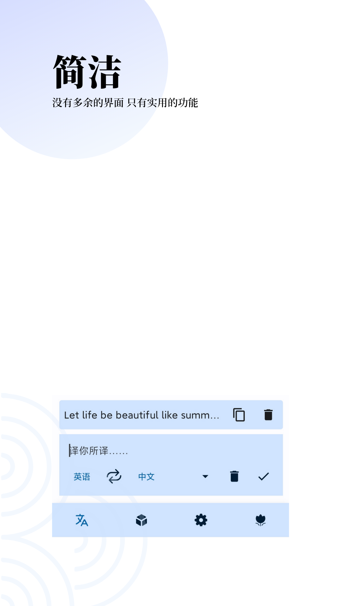
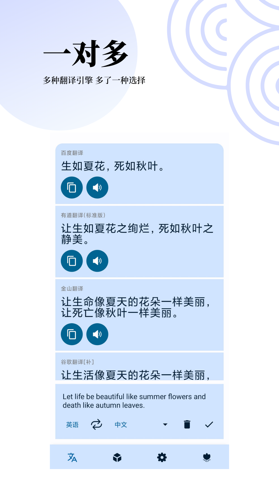
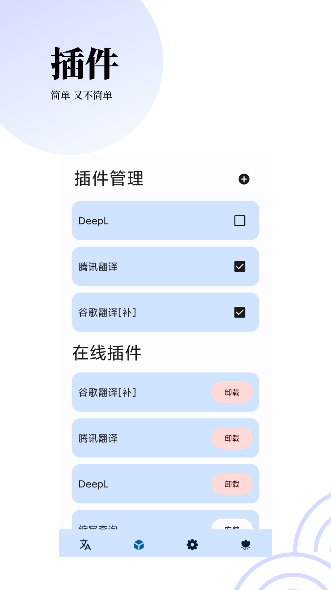
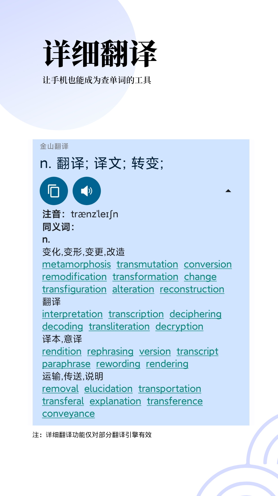
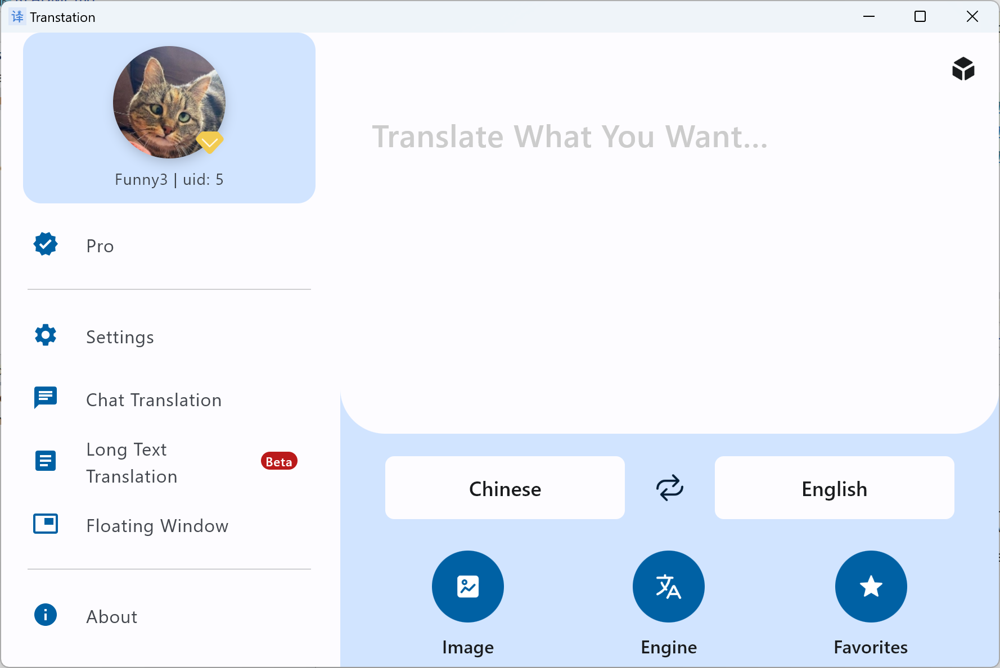
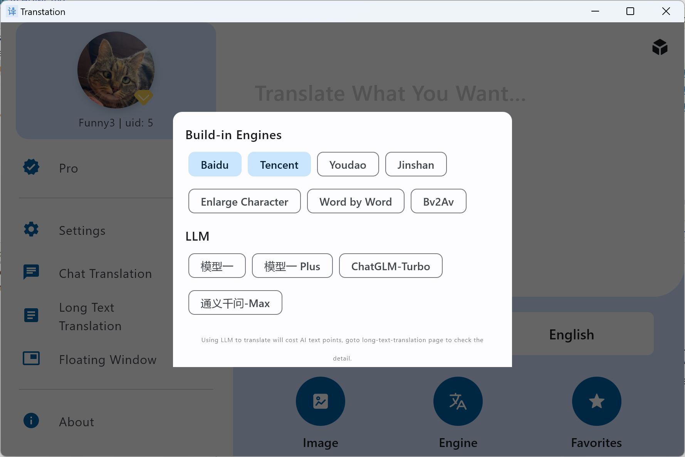

## Transtation

“Transtation”一词由“Translate”（翻译）与“Station”（站点/平台）组合而成。这是一款功能强大且易于使用的翻译软件，支持 Android 和桌面端（基于 JVM），采用 Kotlin Multiplatform（KMP）和 Compose Multiplatform 技术构建。

- 支持同时调用多个翻译引擎（如必应、谷歌、百度、腾讯）进行翻译
- 支持使用多种先进的**大语言模型（LLM）**（如 ChatGPT、GPT-4、ChatGLM、通义千问等）进行翻译
- 支持通过与大语言模型对话进行翻译
- 提供“长文本翻译”功能，可利用大语言模型处理超长文本
- 支持插件开发、下载、更新、导入及导出，具备高度的可扩展性
- 支持图片翻译，并提供多种翻译引擎选择
- 支持屏幕翻译，涵盖悬浮窗翻译、区域截图翻译及全屏截图翻译等多种模式
- 支持自定义主题、语言、翻译引擎等配置
- 满足您在翻译方面的全方位需求

> 受限于开发时间，部分功能暂未在桌面端版本中实现，后续将陆续添加。

### 简介

**本软件是一款主要面向中文用户的翻译工具。同时，它也是一个开源项目，可供学习 Jetpack Compose 或 Compose Multiplatform 的开发者参考。** 本项目是 [Transtation](https://github.com/FunnySaltyFish/FunnyTranslation) 的 KMP（Kotlin Multiplatform）版本；原版软件在 Android 平台上已持续维护了 4 年。本应用具备以下特性：

- 采用 Kotlin Multiplatform + Compose Multiplatform + MVVM + Kotlin Coroutine + Flow + SqlDelight 技术栈
- 采用多模块架构，实现了通用模块（common module）与项目业务模块的分离
- 支持多引擎同步翻译；具备高度可扩展性，支持插件的开发、下载、更新、导入及导出等功能
- 充分利用 Kotlin 语言特性，包括延迟加载（lazy loading）、类代理、协程（Coroutine）、Flow、密封类（sealed classes）、扩展方法、扩展属性以及反射（reflection）等
- 基于 Rhino JS 设计并实现了一套完整的 JavaScript 插件加载、运行及调试环境，为插件开发提供一站式支持
- 适配 Android 11 文件权限；支持双语界面、深色模式以及横屏/平板布局；此外，项目还开发并开源了四个相关库
- 已逐步适配 Android 13，包括：
- 支持为应用单独设置语言
- 支持 Monet 动态图标（Monet icon）

您可以通过以下渠道获取最新版本（支持 Android 和 Windows 平台）：

- [官方网站（中文）](https://www.funnysaltyfish.fun/trans)
- [发布页面](https://github.com/FunnySaltyFish/Transtation-KMP/releases)

欢迎加入 [QQ 群](https://qm.qq.com/q/64Ulp9Rjdm) 下载最新的测试版本。

如果您想阅读源码，建议从 [主 Activity](/composeApp/src/androidMain/kotlin/com/funny/translation/translate/TransActivity.android.kt) 或 [AppNavigation](/composeApp/src/commonMain/kotlin/com/funny/translation/translate/AppNavigation.kt) 开始查看。

如果本项目对您有所帮助，**欢迎点个 Star**！ ### 截图

#### 屏幕录制
> v2.8.0 (2024/01/15)

https://github.com/FunnySaltyFish/Transtation-KMP/assets/46063434/ded5d1c6-553c-4f45-96a4-74d870fcbcb8

#### 运行截图

##### Android

UI v4：
|          |          |          |
| -------- | -------- | -------- |
|  |  |  |
|  |  |  |
|  |  |          |

旧版界面 (v3)

| 截图                                                       | 截图                                                       |
|------------------------------------------------------------|------------------------------------------------------------|
|  |  |
|  |  |

##### 桌面版
* 桌面版目前仍在开发中，界面后续可能会有较大变动。

| 截图                                                               | 截图                                                               |
|--------------------------------------------------------------------|--------------------------------------------------------------------|
|  |  |
